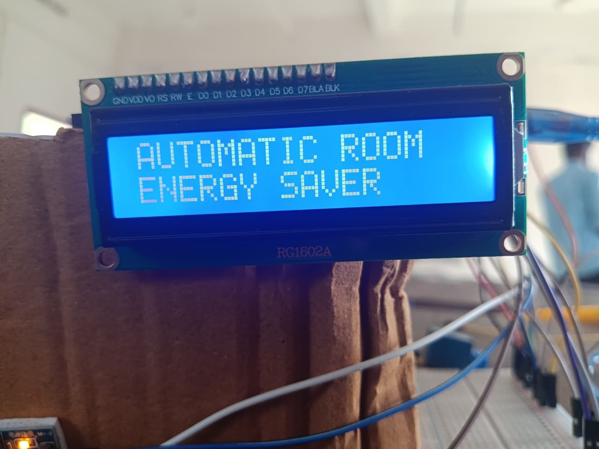
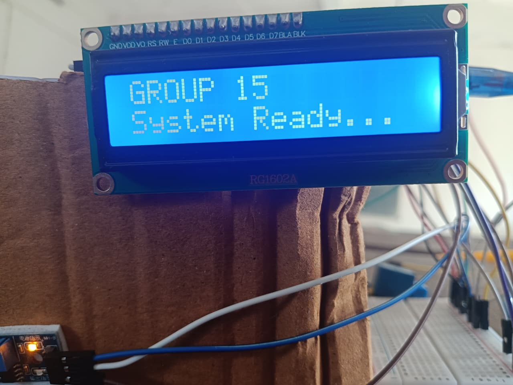
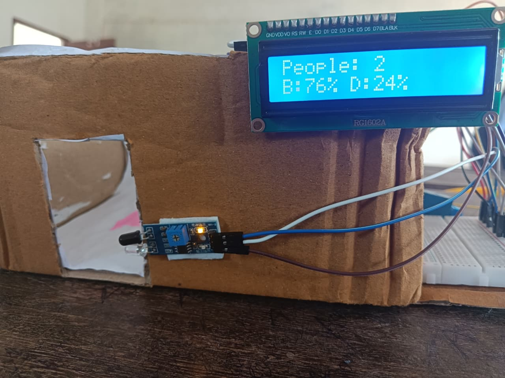

# ⚡ Automatic Room Energy Saver

An intelligent, automated room energy-saving system powered by an **STM32 Blue Pill (STM32F103C8T6)** microcontroller. The system tracks bi-directional room occupancy using infrared sensors and monitors ambient light conditions via an LDR module to automatically control room lighting and appliances, minimizing electricity wastage.

---

## 📸 Hardware Prototype & Demonstration

| Startup Banner | Team Ready Screen |
| :---: | :---: |
|  |  |

### Live Real-Time Operation
*Real-time occupancy tracking and brightness percentage calculation displayed on the 16x2 I2C LCD, with entry/exit IR sensors mounted to the cardboard room frame.*

---

## 🚀 Features
* **Bi-directional Occupancy Tracking:** Accurately counts people entering and exiting using a dual-IR sensor sequence with a smart timeout window.
* **Ambient Light Sensing:** Reads natural light levels to prevent appliances from turning on when the room is already bright.
* **Audio Feedback:** Distinct buzzer alerts (single beep for entry, double beep for exit) for operational feedback.
* **Non-Blocking Architecture:** Uses `millis()` for LCD refreshing to ensure sensor detection is never frozen by display delays.
* **Real-Time Display:** Live status dashboard on a 16x2 I2C LCD showing visitor count, load status, and ambient light percentage.

---

## 🛠️ Hardware & Components
* **Microcontroller:** STM32F103C8T6 (Blue Pill)
* **Sensors:** 
  * 2x Infrared (IR) Obstacle Avoidance Sensors (Entry & Exit)
  * 1x Light Dependent Resistor (LDR) Module
* **Output Actuators & Indicators:**
  * 5V Relay Module (Active-LOW)
  * Jumbo LED (representing room appliances/lighting)
  * Active Buzzer
* **Display:** 16x2 I2C LCD Module

---

## 📌 Hardware Pinout Summary

| Component | Pin on STM32 Blue Pill | Notes |
| :--- | :--- | :--- |
| **16x2 I2C LCD** | SDA $\rightarrow$ PB7 \| SCL $\rightarrow$ PB6 | 5V VCC |
| **IR Sensor 1 (Entry)** | OUT $\rightarrow$ PB12 | Outside Door |
| **IR Sensor 2 (Exit)** | OUT $\rightarrow$ PB13 | Inside Door |
| **LDR Module** | AO $\rightarrow$ PA1 | Analog Light Input |
| **Relay Module** | IN $\rightarrow$ PB0 | Active-LOW Control |
| **Jumbo LED** | Anode $\rightarrow$ PB1 | Via 220 $\Omega$ Resistor |
| **Buzzer** | (+) $\rightarrow$ PA8 | Audio Feedback |

---

## ⚙️ Logic & Operation
1. **The Core Rule:** The Relay and Jumbo LED will **ONLY** turn ON when:
   $$\text{[Visitor Count} > 0\text{]} \quad \text{AND} \quad \text{[Room is Dark}]$$
2. **Entry Sequence:** Breaking IR Sensor 1 followed by IR Sensor 2 within a 3-second window increments the visitor count and triggers a single beep.
3. **Exit Sequence:** Breaking IR Sensor 2 followed by IR Sensor 1 decrements the visitor count and triggers a double beep.

---

## 💻 Software & Libraries
* Programmed using **Arduino IDE** with STM32 Cores.
* Library used: `LiquidCrystal_I2C`.

---

## 👥 Authors & Team (Group 15)
* **Aswin Raj** - [GitHub Profile](https://github.com/Aswin-Raj-R)
* **Gowthami Krishna S** - [GitHub Profile](https://github.com/Gowthamikrishna13)

---